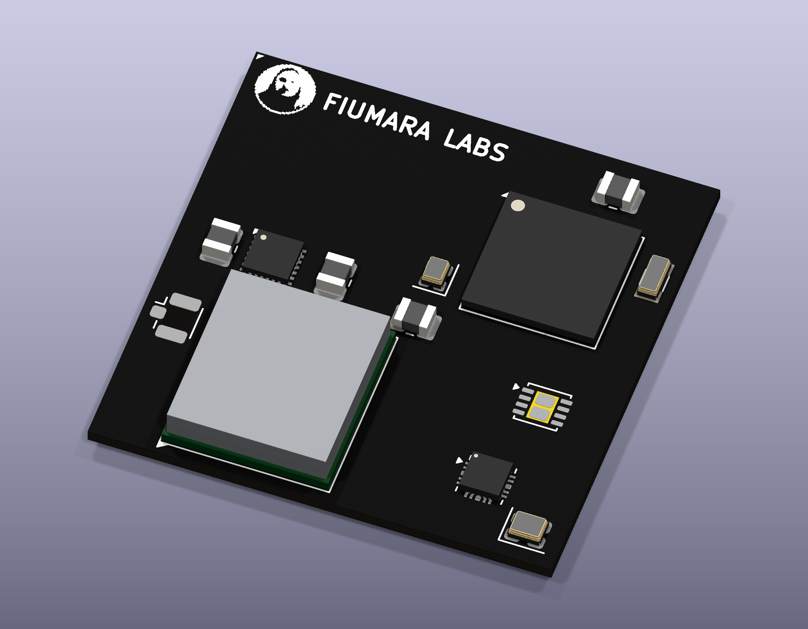

# Fiumara Labs AE3 SoM

*Rev A placement render: KiCad 3D view of `hardware/fiumara-ae3-som.kicad_pcb`, unrouted, with stand-in 3D models; passives are added in M4.*

A 35 × 35 mm solder-down system-on-module with its own 244-pad LGA edge
([edge pinout](docs/edge-pinout.md)). The design is drawn from vendor datasheets.

## Revision A part set

| Function | Part | Source |
| --- | --- | --- |
| SoC | Alif Ensemble E3, `AE302F80F55D5LE` (FBGA194, 0.5 mm) | ADTS0007 v2.12 |
| Wi‑Fi 6 + BLE 5.4 | BDE-BW3501N (TI CC3501E), ANT-pin variant | BDE-BW3501 datasheet V0.6, TI SWRS343A |
| Ethernet PHY | TI DP83825I (10/100, RMII) | TI SNLS638C |
| PMIC | TI TPS6521402 (TPS65214 family, AM62L NVM) | TI SLVSHK7A, SLVUD78 |
| CAN (assembly option) | TI TCAN1044AV-Q1 | TI SLLSFJ3D |

## Licence

The hardware design files and documentation are licensed under the
[CERN Open Hardware Licence Version 2 – Strongly Reciprocal](LICENSE) (SPDX: `CERN-OHL-S-2.0`).

## Milestones

| # | Deliverable | Status |
| --- | --- | --- |
| M1 | Requirements, architecture, power tree, interface scope, source manifest | done — [docs/architecture.md](docs/architecture.md) |
| M2 | KiCad symbols and footprints for SoC, radio, PHY, PMIC and the LGA edge; pin-number checks against the datasheets; placement floorplan | done — [docs/m2-library.md](docs/m2-library.md) |
| M3 | Own edge pinout and ball-level pin allocation (edge net → Alif ball/mux), checked by script | in review — [docs/m3-pin-allocation.md](docs/m3-pin-allocation.md) |
| M4 | Schematic sheets (power, SoC, radio, Ethernet, CAN/USB, edge) generated by script, clean ERC | — |
| M5 | Review pass, per-SoM manifest draft, open-item list for layout | — |

Every milestone is a commit you can inspect on its own. Vendor PDFs live outside git in
the vendor-docs folder (see `docs/sources.md`).
