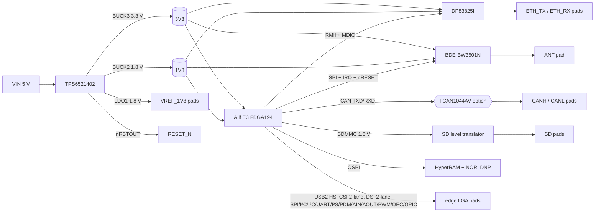

# M1 — Requirements and architecture (Rev A)

Status: done; the edge definition was revised in M3 (own pinout, see [edge-pinout.md](edge-pinout.md)).
Page and table references point to the documents in `docs/sources.md`.

## 1. Module requirements

| Requirement | Rev A response |
| --- | --- |
| One 5 V input (`VIN`, 6 pads); every rail made on-module; I²C-controlled PMIC | TPS6521402 on VSYS = 5 V, I²C on its own SoC bus |
| Run from 4.75–5.25 V and survive 5.5 V | TPS65214 VSYS abs max 6 V (SLVSHK7A §6.1 1.1.1); bulk input capacitance on-module |
| A 1.8 V reference output for carrier level shifters (`VREF_1V8`, ≤ 100 mA) | PMIC LDO1 (1.8 V, 300 mA), separate from the on-module 1.8 V rail |
| The module sequences its own rails; `RESET_N` high means the carrier may drive I/O | PMIC slot sequence; `nRSTOUT` wired-AND with the SoC `POR_N` onto `RESET_N` |
| `EN` turns the module off when pulled low, 5 V tolerant, floating = on | `EN` → PMIC `EN/PB/VSENSE` (abs max 6 V, SLVSHK7A §6.1 1.1.6), 1 MΩ to VIN |
| Boot needs no straps | Ensemble boots from on-chip MRAM |
| Wired Ethernet, Wi‑Fi 6 + BLE 5.4 on a 50 Ω antenna pad, CAN | DP83825I 10/100; BDE-BW3501N with ANT-pin output; CAN logic pads always, CANH/CANL pads with the TCAN1044AV fitted |
| All digital I/O at 1.8 V except the SD card pads | SoC `VDD_IO_1V8` and `VDD_IO_FLEX` both at 1.8 V; SD through a level translator |

## 2. Block diagram

## 3. Power tree and budget

The SoC ranges come from ADTS0007 Table 5-4 (p.127–128). The radio currents come from
BDE-BW3501 Table 6 and Table 8 (p.50–51).

| Rail | Source | Loads | Peak estimate | Source limit |
| --- | --- | --- | --- | --- |
| 3V3 | BUCK3 (VSEL pin low → 3.3 V, SLVUD78 §2.1) | E3 `VDD_MAIN`/`VDD_BATT`/`VDD_BUCK` (1.75–4.2 V), `VDD_USB_3V3`; BW3501 `VDD_3V3` (495 mA peak during calibration); DP83825 AVDD; SD card switch | ~0.75 A + SD card | 1 A in this NVM (SLVUD78), 2 A device rating |
| 1V8 | BUCK2 1.8 V | E3 `VDD_IO_1V8`, `VDD_IO_FLEX`; BW3501 `VDD_1V8` (400 mA peak) + `VIO1/VIO2/VDD_SF`; DP83825 VDDIO; OSPI memories when fitted | ~0.55 A | 1 A |
| VREF_1V8 | LDO1 1.8 V | carrier only | 100 mA | 300 mA |
| BUCK1 0.75 V, LDO2 2.5 V | fixed by NVM | unused, held at minimum output capacitance; may be turned off over I²C after boot | — | — |

The SoC makes its own 0.8 V core rail with an internal buck, so VSW needs its inductor
on-module. `VDD_BATT` must be tied to `VDD_MAIN` (Table 3-2 note 1), so there is **no
independent RTC backup domain** in Rev A.

Mandatory SoC passives (Table 3-2 notes 3–4): `VREG_DIG_1V8` gets 1 µF + 10 Ω in series
(because VDD_MAIN > 1.9 V), and `VREG_AON` gets 1 µF + 1 kΩ in series. The datasheet
warns that leaving these out can damage the device.

## 4. Interfaces

The edge interface set, its pad positions and its net names are defined in
[edge-pinout.md](edge-pinout.md); the SoC ball behind each net is in [pinmap.md](pinmap.md).

## 5. Open items (need evidence or an owner decision)

1. **Wi‑Fi host link.** E3 has only one SDMMC, and Rev A gives it to the SD pads, so the
   radio uses SPI. Before M4 we need evidence that the CC3501E firmware supports a hosted
   network-processor mode over **SPI** (not only SDIO). If it doesn't, either the radio
   takes SDMMC and SD is dropped, or SD moves to SPI mode.
2. **TPS6521402 NVM fit.** BUCK1 (0.75 V) and LDO2 (2.5 V) are unused, and BUCK3's
   current limit is set to 1 A. Check the 3V3 peak against the datasheet's current-limit
   tolerance in M4. The other route is the user-programmable TPS6521905, which needs NVM
   programming in production.
3. **Radio flash size.** BW3501N42 (4 MB) vs N82 (8 MB) vs N162 (16 MB). This depends on
   the firmware image plus OTA slot size.
4. **SD translator part.** To be chosen in M4. It must be I_off-safe when 3.3 V is down.
