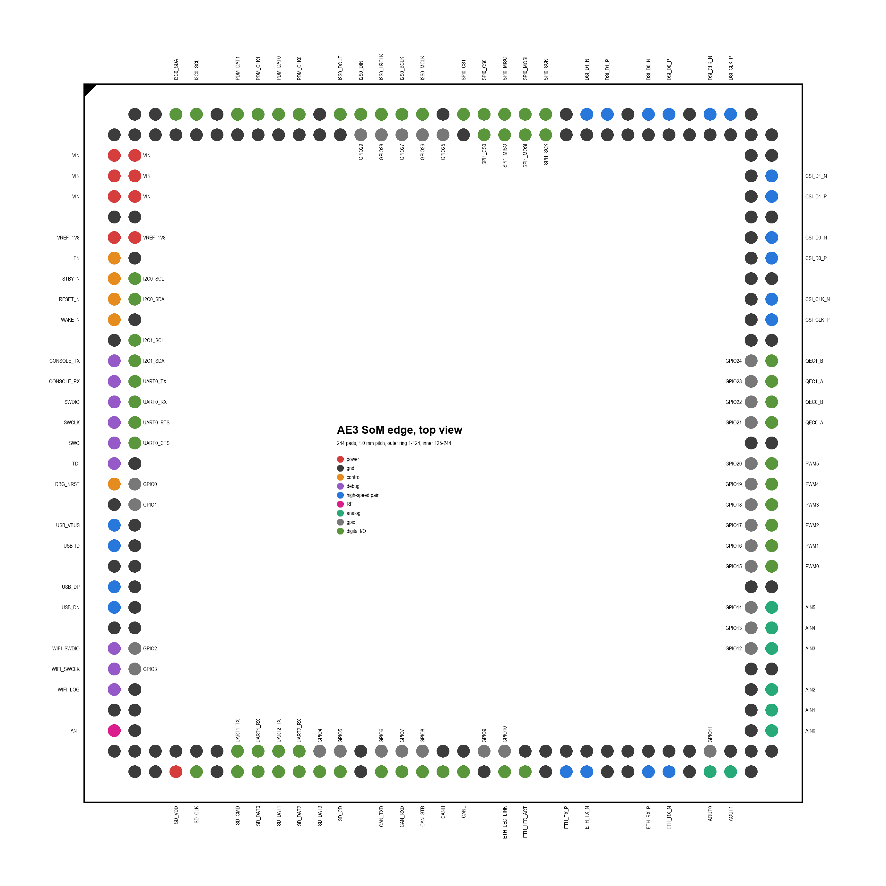

# Edge pinout

Generated by `scripts/gen_docs.py` from `hardware/data/edge_pinout.json` (`scripts/gen_edge.py`). Do not edit.

This is the Fiumara Labs AE3 SoM's own edge pinout: a 35 × 35 mm LGA module with 244 round 0.60 mm pads at 1.0 mm pitch in two rings, numbered anticlockwise from the top of the left side (outer ring 1–124, inner ring 125–244).

## Non-SoC nets

| Net | Pads | Connection |
| --- | --- | --- |
| VIN | 2, 3, 4, 126, 127, 128 | 5 V input: PMIC VSYS/PVIN, CAN transceiver VCC |
| VREF_1V8 | 6, 130 | PMIC LDO1, 1.8 V I/O reference output for carrier level shifters (<= 100 mA) |
| EN | 7 | PMIC EN/PB/VSENSE; 1 MOhm pull-up to VIN, 5 V tolerant, open-drain to turn the module off |
| STBY_N | 8 | PMIC MODE/STBY, pull-up to 1V8 |
| RESET_N | 9 | PMIC nRSTOUT and Alif POR_N, open-drain wired-AND, pull-up to 1V8 |
| ETH_TX_P | 53 | PHY TD_P |
| ETH_TX_N | 54 | PHY TD_M |
| ETH_RX_P | 57 | PHY RD_P |
| ETH_RX_N | 58 | PHY RD_M |
| ETH_LED_LINK | 50 | PHY LED_0 |
| ETH_LED_ACT | 51 | PHY LED_1 |
| ANT | 30 | Wi-Fi module ANT0, 50 Ohm (DNP U.FL alternative on the module) |
| SD_VDD | 34 | 3.3 V SD card supply, load switch controlled by SD_PWR_EN |
| CANH | 47 | CAN transceiver CANH (assembly option) |
| CANL | 48 | CAN transceiver CANL (assembly option) |
| WIFI_SWDIO | 26 | Wi-Fi module SWDIO (factory programming) |
| WIFI_SWCLK | 27 | Wi-Fi module SWCLK (factory programming) |
| WIFI_LOG | 28 | Wi-Fi module LOGGER UART output |

## All pads

| Pad | x, y (mm) | Ring | Net |
| --- | --- | --- | --- |
| 1 | -16, -15 | outer | GND |
| 2 | -16, -14 | outer | VIN |
| 3 | -16, -13 | outer | VIN |
| 4 | -16, -12 | outer | VIN |
| 5 | -16, -11 | outer | GND |
| 6 | -16, -10 | outer | VREF_1V8 |
| 7 | -16, -9 | outer | EN |
| 8 | -16, -8 | outer | STBY_N |
| 9 | -16, -7 | outer | RESET_N |
| 10 | -16, -6 | outer | WAKE_N |
| 11 | -16, -5 | outer | GND |
| 12 | -16, -4 | outer | CONSOLE_TX |
| 13 | -16, -3 | outer | CONSOLE_RX |
| 14 | -16, -2 | outer | SWDIO |
| 15 | -16, -1 | outer | SWCLK |
| 16 | -16, 0 | outer | SWO |
| 17 | -16, 1 | outer | TDI |
| 18 | -16, 2 | outer | DBG_NRST |
| 19 | -16, 3 | outer | GND |
| 20 | -16, 4 | outer | USB_VBUS |
| 21 | -16, 5 | outer | USB_ID |
| 22 | -16, 6 | outer | GND |
| 23 | -16, 7 | outer | USB_DP |
| 24 | -16, 8 | outer | USB_DN |
| 25 | -16, 9 | outer | GND |
| 26 | -16, 10 | outer | WIFI_SWDIO |
| 27 | -16, 11 | outer | WIFI_SWCLK |
| 28 | -16, 12 | outer | WIFI_LOG |
| 29 | -16, 13 | outer | GND |
| 30 | -16, 14 | outer | ANT |
| 31 | -16, 15 | outer | GND |
| 32 | -15, 16 | outer | GND |
| 33 | -14, 16 | outer | GND |
| 34 | -13, 16 | outer | SD_VDD |
| 35 | -12, 16 | outer | SD_CLK |
| 36 | -11, 16 | outer | GND |
| 37 | -10, 16 | outer | SD_CMD |
| 38 | -9, 16 | outer | SD_DAT0 |
| 39 | -8, 16 | outer | SD_DAT1 |
| 40 | -7, 16 | outer | SD_DAT2 |
| 41 | -6, 16 | outer | SD_DAT3 |
| 42 | -5, 16 | outer | SD_CD |
| 43 | -4, 16 | outer | GND |
| 44 | -3, 16 | outer | CAN_TXD |
| 45 | -2, 16 | outer | CAN_RXD |
| 46 | -1, 16 | outer | CAN_STB |
| 47 | 0, 16 | outer | CANH |
| 48 | 1, 16 | outer | CANL |
| 49 | 2, 16 | outer | GND |
| 50 | 3, 16 | outer | ETH_LED_LINK |
| 51 | 4, 16 | outer | ETH_LED_ACT |
| 52 | 5, 16 | outer | GND |
| 53 | 6, 16 | outer | ETH_TX_P |
| 54 | 7, 16 | outer | ETH_TX_N |
| 55 | 8, 16 | outer | GND |
| 56 | 9, 16 | outer | GND |
| 57 | 10, 16 | outer | ETH_RX_P |
| 58 | 11, 16 | outer | ETH_RX_N |
| 59 | 12, 16 | outer | GND |
| 60 | 13, 16 | outer | AOUT0 |
| 61 | 14, 16 | outer | AOUT1 |
| 62 | 15, 16 | outer | GND |
| 63 | 16, 15 | outer | GND |
| 64 | 16, 14 | outer | AIN0 |
| 65 | 16, 13 | outer | AIN1 |
| 66 | 16, 12 | outer | AIN2 |
| 67 | 16, 11 | outer | GND |
| 68 | 16, 10 | outer | AIN3 |
| 69 | 16, 9 | outer | AIN4 |
| 70 | 16, 8 | outer | AIN5 |
| 71 | 16, 7 | outer | GND |
| 72 | 16, 6 | outer | PWM0 |
| 73 | 16, 5 | outer | PWM1 |
| 74 | 16, 4 | outer | PWM2 |
| 75 | 16, 3 | outer | PWM3 |
| 76 | 16, 2 | outer | PWM4 |
| 77 | 16, 1 | outer | PWM5 |
| 78 | 16, 0 | outer | GND |
| 79 | 16, -1 | outer | QEC0_A |
| 80 | 16, -2 | outer | QEC0_B |
| 81 | 16, -3 | outer | QEC1_A |
| 82 | 16, -4 | outer | QEC1_B |
| 83 | 16, -5 | outer | GND |
| 84 | 16, -6 | outer | CSI_CLK_P |
| 85 | 16, -7 | outer | CSI_CLK_N |
| 86 | 16, -8 | outer | GND |
| 87 | 16, -9 | outer | CSI_D0_P |
| 88 | 16, -10 | outer | CSI_D0_N |
| 89 | 16, -11 | outer | GND |
| 90 | 16, -12 | outer | CSI_D1_P |
| 91 | 16, -13 | outer | CSI_D1_N |
| 92 | 16, -14 | outer | GND |
| 93 | 16, -15 | outer | GND |
| 94 | 15, -16 | outer | GND |
| 95 | 14, -16 | outer | DSI_CLK_P |
| 96 | 13, -16 | outer | DSI_CLK_N |
| 97 | 12, -16 | outer | GND |
| 98 | 11, -16 | outer | DSI_D0_P |
| 99 | 10, -16 | outer | DSI_D0_N |
| 100 | 9, -16 | outer | GND |
| 101 | 8, -16 | outer | DSI_D1_P |
| 102 | 7, -16 | outer | DSI_D1_N |
| 103 | 6, -16 | outer | GND |
| 104 | 5, -16 | outer | SPI0_SCK |
| 105 | 4, -16 | outer | SPI0_MOSI |
| 106 | 3, -16 | outer | SPI0_MISO |
| 107 | 2, -16 | outer | SPI0_CS0 |
| 108 | 1, -16 | outer | SPI0_CS1 |
| 109 | 0, -16 | outer | GND |
| 110 | -1, -16 | outer | I2S0_MCLK |
| 111 | -2, -16 | outer | I2S0_BCLK |
| 112 | -3, -16 | outer | I2S0_LRCLK |
| 113 | -4, -16 | outer | I2S0_DIN |
| 114 | -5, -16 | outer | I2S0_DOUT |
| 115 | -6, -16 | outer | GND |
| 116 | -7, -16 | outer | PDM_CLK0 |
| 117 | -8, -16 | outer | PDM_DAT0 |
| 118 | -9, -16 | outer | PDM_CLK1 |
| 119 | -10, -16 | outer | PDM_DAT1 |
| 120 | -11, -16 | outer | GND |
| 121 | -12, -16 | outer | I3C0_SCL |
| 122 | -13, -16 | outer | I3C0_SDA |
| 123 | -14, -16 | outer | GND |
| 124 | -15, -16 | outer | GND |
| 125 | -15, -15 | inner | GND |
| 126 | -15, -14 | inner | VIN |
| 127 | -15, -13 | inner | VIN |
| 128 | -15, -12 | inner | VIN |
| 129 | -15, -11 | inner | GND |
| 130 | -15, -10 | inner | VREF_1V8 |
| 131 | -15, -9 | inner | GND |
| 132 | -15, -8 | inner | I2C0_SCL |
| 133 | -15, -7 | inner | I2C0_SDA |
| 134 | -15, -6 | inner | GND |
| 135 | -15, -5 | inner | I2C1_SCL |
| 136 | -15, -4 | inner | I2C1_SDA |
| 137 | -15, -3 | inner | UART0_TX |
| 138 | -15, -2 | inner | UART0_RX |
| 139 | -15, -1 | inner | UART0_RTS |
| 140 | -15, 0 | inner | UART0_CTS |
| 141 | -15, 1 | inner | GND |
| 142 | -15, 2 | inner | GPIO0 |
| 143 | -15, 3 | inner | GPIO1 |
| 144 | -15, 4 | inner | GND |
| 145 | -15, 5 | inner | GND |
| 146 | -15, 6 | inner | GND |
| 147 | -15, 7 | inner | GND |
| 148 | -15, 8 | inner | GND |
| 149 | -15, 9 | inner | GND |
| 150 | -15, 10 | inner | GPIO2 |
| 151 | -15, 11 | inner | GPIO3 |
| 152 | -15, 12 | inner | GND |
| 153 | -15, 13 | inner | GND |
| 154 | -15, 14 | inner | GND |
| 155 | -15, 15 | inner | GND |
| 156 | -14, 15 | inner | GND |
| 157 | -13, 15 | inner | GND |
| 158 | -12, 15 | inner | GND |
| 159 | -11, 15 | inner | GND |
| 160 | -10, 15 | inner | UART1_TX |
| 161 | -9, 15 | inner | UART1_RX |
| 162 | -8, 15 | inner | UART2_TX |
| 163 | -7, 15 | inner | UART2_RX |
| 164 | -6, 15 | inner | GPIO4 |
| 165 | -5, 15 | inner | GPIO5 |
| 166 | -4, 15 | inner | GND |
| 167 | -3, 15 | inner | GPIO6 |
| 168 | -2, 15 | inner | GPIO7 |
| 169 | -1, 15 | inner | GPIO8 |
| 170 | 0, 15 | inner | GND |
| 171 | 1, 15 | inner | GND |
| 172 | 2, 15 | inner | GPIO9 |
| 173 | 3, 15 | inner | GPIO10 |
| 174 | 4, 15 | inner | GND |
| 175 | 5, 15 | inner | GND |
| 176 | 6, 15 | inner | GND |
| 177 | 7, 15 | inner | GND |
| 178 | 8, 15 | inner | GND |
| 179 | 9, 15 | inner | GND |
| 180 | 10, 15 | inner | GND |
| 181 | 11, 15 | inner | GND |
| 182 | 12, 15 | inner | GND |
| 183 | 13, 15 | inner | GPIO11 |
| 184 | 14, 15 | inner | GND |
| 185 | 15, 15 | inner | GND |
| 186 | 15, 14 | inner | GND |
| 187 | 15, 13 | inner | GND |
| 188 | 15, 12 | inner | GND |
| 189 | 15, 11 | inner | GND |
| 190 | 15, 10 | inner | GPIO12 |
| 191 | 15, 9 | inner | GPIO13 |
| 192 | 15, 8 | inner | GPIO14 |
| 193 | 15, 7 | inner | GND |
| 194 | 15, 6 | inner | GPIO15 |
| 195 | 15, 5 | inner | GPIO16 |
| 196 | 15, 4 | inner | GPIO17 |
| 197 | 15, 3 | inner | GPIO18 |
| 198 | 15, 2 | inner | GPIO19 |
| 199 | 15, 1 | inner | GPIO20 |
| 200 | 15, 0 | inner | GND |
| 201 | 15, -1 | inner | GPIO21 |
| 202 | 15, -2 | inner | GPIO22 |
| 203 | 15, -3 | inner | GPIO23 |
| 204 | 15, -4 | inner | GPIO24 |
| 205 | 15, -5 | inner | GND |
| 206 | 15, -6 | inner | GND |
| 207 | 15, -7 | inner | GND |
| 208 | 15, -8 | inner | GND |
| 209 | 15, -9 | inner | GND |
| 210 | 15, -10 | inner | GND |
| 211 | 15, -11 | inner | GND |
| 212 | 15, -12 | inner | GND |
| 213 | 15, -13 | inner | GND |
| 214 | 15, -14 | inner | GND |
| 215 | 15, -15 | inner | GND |
| 216 | 14, -15 | inner | GND |
| 217 | 13, -15 | inner | GND |
| 218 | 12, -15 | inner | GND |
| 219 | 11, -15 | inner | GND |
| 220 | 10, -15 | inner | GND |
| 221 | 9, -15 | inner | GND |
| 222 | 8, -15 | inner | GND |
| 223 | 7, -15 | inner | GND |
| 224 | 6, -15 | inner | GND |
| 225 | 5, -15 | inner | SPI1_SCK |
| 226 | 4, -15 | inner | SPI1_MOSI |
| 227 | 3, -15 | inner | SPI1_MISO |
| 228 | 2, -15 | inner | SPI1_CS0 |
| 229 | 1, -15 | inner | GND |
| 230 | 0, -15 | inner | GPIO25 |
| 231 | -1, -15 | inner | GPIO26 |
| 232 | -2, -15 | inner | GPIO27 |
| 233 | -3, -15 | inner | GPIO28 |
| 234 | -4, -15 | inner | GPIO29 |
| 235 | -5, -15 | inner | GND |
| 236 | -6, -15 | inner | GND |
| 237 | -7, -15 | inner | GND |
| 238 | -8, -15 | inner | GND |
| 239 | -9, -15 | inner | GND |
| 240 | -10, -15 | inner | GND |
| 241 | -11, -15 | inner | GND |
| 242 | -12, -15 | inner | GND |
| 243 | -13, -15 | inner | GND |
| 244 | -14, -15 | inner | GND |
