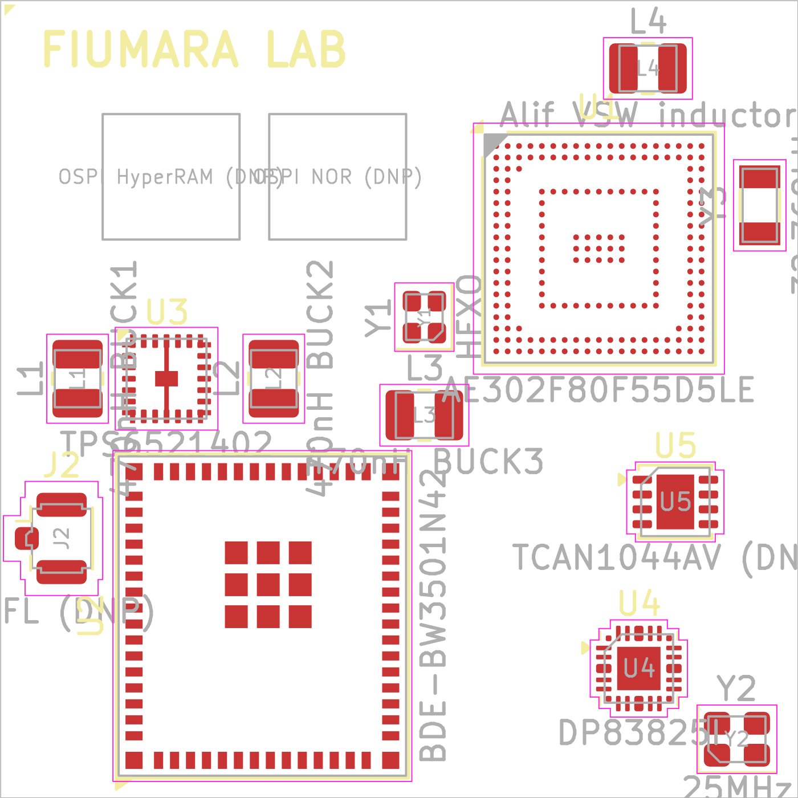
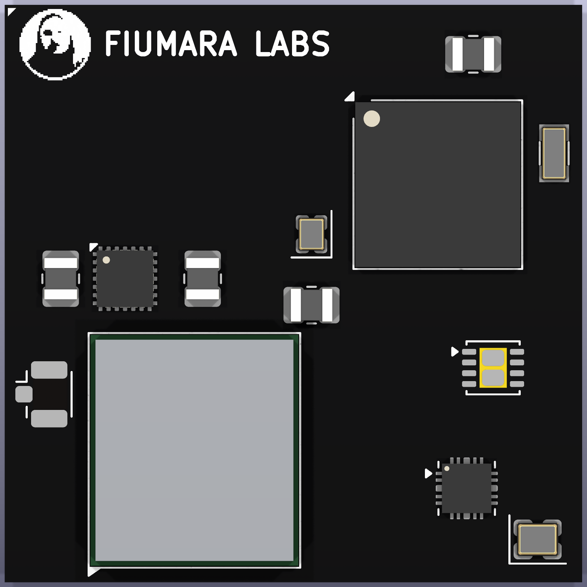

# M2 — Library and floorplan

Status: in review.

## How to regenerate

```sh
python3 scripts/extract_alif_pins.py <alif_E3_datasheet.pdf> hardware/data/alif_e3_fbga194.json
python3 scripts/gen_lib.py                 # hardware/lib/fiumara-ae3-som.kicad_sym + fiumara-ae3-som.pretty/
python3 scripts/check_lib.py [vendor-docs] # pin and pad checks (see below)
KP=/Applications/KiCad/KiCad.app/Contents/Frameworks/Python.framework/Versions/Current/bin/python3
$KP scripts/gen_floorplan.py               # hardware/fiumara-ae3-som.kicad_pcb (placement only)
python scripts/render_lib.py <outdir>      # PNG of every symbol unit and footprint, for review
```

Commit changes to the generators, not hand edits to the generated files.

## Parts

| Ref | Symbol | Footprint | Pin source |
| --- | --- | --- | --- |
| U1 | `AE302F80F55D5LE`, 6 units: power, system/USB/MIPI, and GPIO P0–P3, P4–P7, P8–P11, P12–P15. Every GPIO carries its mux functions as KiCad pin alternates | `Alif_FBGA-194_10x10mm_Layout19x19_P0.5mm` (0.25 mm NSMD) | ADTS0007 v2.12 Table 4-1, Fig 4-2, Fig 6-5 |
| U2 | `BDE-BW3501N` | `BDE-BW3501N_14x12.6mm` (64 edge + 9 ground pads) | BDE-BW3501 V0.6 Table 2, Fig 6, Fig 16–17 |
| U3 | `TPS6521402` | `TI_VAF0024A_WQFN-HR-24_3.5x3.5mm_P0.5mm` (L corner pads, PGND bar) | SLVSHK7A Table 5-1, VAF0024A board layout |
| U4 | `DP83825I` (KiCad stock, copied unchanged) | stock `Texas_RMQ0024A_WQFN-24-1EP_3x3mm_P0.4mm` | KiCad 10 library |
| U5 | `TCAN1044AVDRBRQ1` | stock `VSON-8-1EP_3x3mm_P0.65mm_EP1.65x2.4mm` | SLLSFJ3D Table 5-1 |
| J1 | `AE3_SoM_Edge_244`, 5 units | `AE3_SoM_LGA-244_35x35mm_P1.0mm_BottomPads` (0.60 mm pads on **B.Cu**, top-view coordinates) | `hardware/data/edge_pinout.json` (own pinout, M3) |

## What `check_lib.py` checks

- For every symbol, the pin numbers equal the pad numbers of its footprint.
- The Alif symbol matches the extracted ball table exactly. The extractor checks itself against
  194 unique balls and against spot checks of Figure 4-2.
- The edge symbol names match `edge_pinout.json`, and every footprint pad sits at its
  generated position.
- The BW3501N, TPS65214 and TCAN1044A pin names are re-parsed from the datasheet PDFs and
  compared to the symbols.
- The DP83825I symbol is identical to KiCad's stock symbol.

I also ran a negative test: renaming one pin each in the BW3501N, TPS and edge symbols made all
three checks fail.

## Datasheet findings recorded during M2

- **Alif VSS balls.** Table 4-1 lists 7 VSS balls, but Figure 4-2 also shows VSS at B2, C18 and
  J10, and only with those does the total reach 194. The figure is taken as authoritative.
- **Alif flex I/O.** Only P7_4–P7_7 and P15_0–P15_3 are on `VDD_IO_FLEX`. P15_4–P15_7 are on
  `VDD_IO_1V8`.
- **TPS65214 PGND.** Pins 10 and 22 join the exposed pad through copper strips in TI's land
  pattern. Until nets are assigned, DRC reports 4 clearance/mask items between pads 10, 22 and
  25. They disappear once all three are on GND (M4).
- **Module thickness.** 1.0 mm module PCB. Bottom-side components may go inside the pad rings
  (28.4 × 28.4 mm area marked on B.Fab).

## Floorplan





The render uses a 6-layer, 1.0 mm stackup with black mask, white silk and ENIG, set by `gen_floorplan.py`. The BGA and PMIC are shown with scaled stock KiCad models, and the Wi‑Fi module with a simple VRML can from `scripts/gen_models.py`. The silkscreen logo is the fiumaralabs.com favicon, turned into a 1-bit bitmap by `scripts/gen_logo.py` (48 px at 0.09 mm, 4.3 mm across).

U1 is the SoC (top right). U2 is the Wi‑Fi module (bottom
left), rotated 90° so that ANT0 (pin 63) faces the `ANT` edge pad (pad 30, bottom of the left side). U3 is the PMIC with
L1/L2 on the left. U4 is the PHY with its 25 MHz crystal Y2 (bottom right). U5 is the optional
CAN transceiver. The two outlined boxes top left are reserved for the DNP OSPI HyperRAM and NOR.
J2 is a DNP U.FL connector, an alternative to the pad antenna path.
